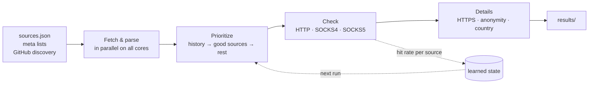
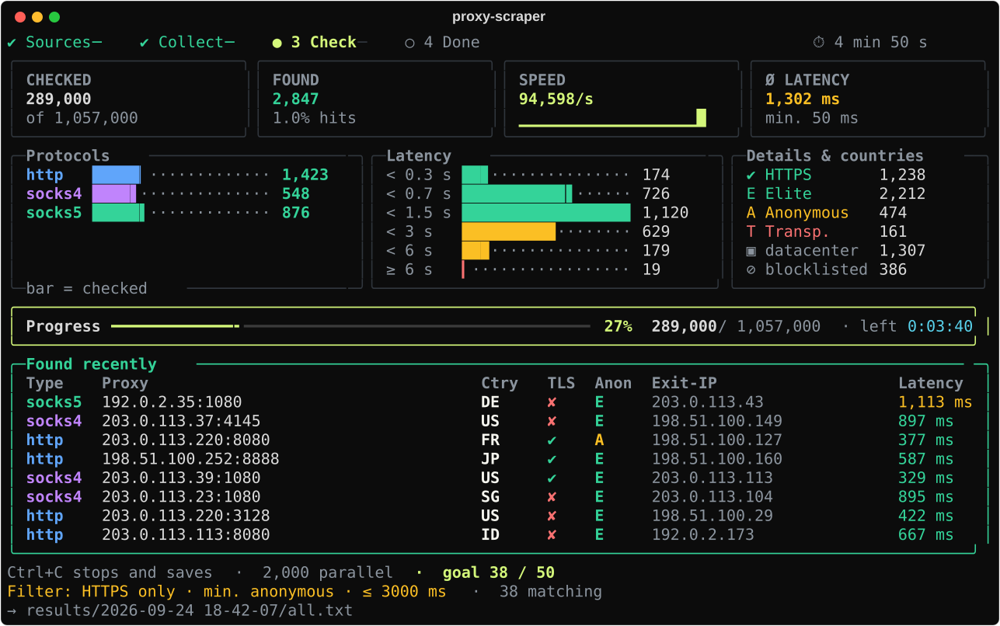
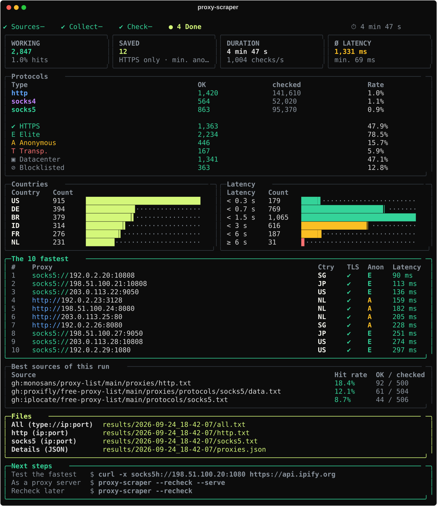

# How it works

← [README](../README.md) · [All docs](README.md)

## The checks, step by step

<picture>
  <source media="(prefers-color-scheme: dark)" srcset="checks-dark.svg">
  <source media="(prefers-color-scheme: light)" srcset="checks-light.svg">
  
</picture>




1. **Sources** – the curated list in [`sources.json`](../proxyscraper/sources.json), meta sources (other projects that maintain lists of proxy sources) and, once a day, a GitHub search for actively maintained repos. Every search adds to what earlier ones found; a list the search hasn't seen for three weeks drops out. Lists found by the search or named in someone else's meta list are only downloaded from public addresses: every address the name resolves to and every redirect is checked, and the connection goes to the address that was checked – a list whose name points to `127.0.0.1`, your router or another internal address is skipped. The curated lists and your own (`--source`, also `localhost` and files) are not restricted.
2. **Collect** – plain text, HTML tables, JSON APIs and `type://ip:port` lines are recognized; private and reserved address ranges are dropped. Lists that haven't changed since the last run answer `304` and come from a local cache – a second run right after the first loads only what changed (in one logged hourly run 52 MB, with 431 of 746 lists unchanged).
3. **Prioritize** – known working proxies first, then by the learned hit rate of their sources.
4. **Check** – every proxy has to fetch its exit IP from a check target (`checkip.amazonaws.com`, with `ifconfig.me`, `ipinfo.io`, `wtfismyip.com` and `ident.me` as reserves – none of them behind Cloudflare) and return a valid, *foreign* IP. If the target goes down mid-run, the tool switches and re-checks the proxies that were affected, so the statistics don't learn from an outage. The targets of the later checks are asked directly when a check against them fails; if they don't answer either, the proxy's check is `unavailable`, not `failed`. Anyone passing your own IP through is out. Then comes the **second request** via `httpbin.org`, which has to see the same exit IP: proxies that only answer the first check with “200 + IP” fail here, and so do unstable ones and exits that rotate. Finally a static HTML page has to arrive byte for byte as it does without a proxy. Each of these leaves [its outcome](check-states.md) on the result.
5. **Countries and providers** – looked up offline in the free DB-IP databases, including the provider (ASN) and whether the provider's name looks like a hosting company (between 45 % and 65 % of the entries in the lists we looked at) (downloaded once a month, ~2 µs per lookup); ip-api.com is only asked for the few addresses it doesn't know.
6. **Blocklists** – one DNS lookup per exit IP against SpamCop, cached for the run: between 28 % and 43 % of the entries exited from a listed IP in the lists we looked at, and sites that use the list show those captchas or block them. `--no-blocklisted` drops them. If your DNS resolver is refused by SpamCop (large public resolvers are), the lookup is skipped instead of guessing.
7. **Learn** – hit rates and history are stored. Sources without hits, with content unchanged for a week or permanently unreachable are skipped.

<details>
<summary><b>📸 See the live dashboard and final report</b></summary>
<br>
<div align="center">

<br><br>

<sub>Illustration: the real interface, rendered with sample data by <a href="make_demo.py">docs/make_demo.py</a>. The numbers in it are made up.</sub>
</div>
</details>

## Features

<table>
<tr>
<td width="50%" valign="top">

**Setup wizard**<br>
Started without arguments, the tool asks what you need using the arrow keys – a preset or step by step. At the end it shows the matching command line.

</td>
<td width="50%" valign="top">

**Fast**<br>
350+ curated lists, plus the ones found through meta lists and GitHub search (about 750 to 820 in the hourly runs), fetched in parallel. Large lists are parsed on all CPU cores, and hand-written HTTP/SOCKS handshakes run directly on `asyncio`, 2,000 checks at once.

</td>
</tr>
<tr>
<td valign="top">

**Real verification**<br>
Every hit has to answer **a second request** to an unrelated site with the same exit IP: over 3.6 million checks, 54 % of the proxies that answered the first request did not pass the second. A third request fetches **a static test page that has to arrive byte for byte**: for 5.2 % of the proxies that got that far it didn't. Why a proxy fails either one (unstable, a rotating exit, a changed or cut-off page) is not something those runs recorded; from 1.30 on every result carries a reason code, and 132 published runs now say what those failures are: across 19.8 million checks, a *different exit IP* on the second request is 1.81 % of that step, while plain timeouts are 27.9 % ([why free proxies fail](why-free-proxies-fail.md), [the numbers](free-proxies-in-numbers.md), [check states](check-states.md)). Plus: HTTPS through a tunnel with **a TLS certificate that verifies** for the test host, anonymity level *elite / anonymous / transparent* and the country of the exit IP.

</td>
<td valign="top">

**Learns with every run**<br>
Hit rate per source, history of working proxies, automatic removal of dead and stale lists. With `-l 5000` you get the *best* 5000 candidates, not just any.

</td>
</tr>
<tr>
<td valign="top">

**Finds new sources by itself**<br>
Searches GitHub for actively maintained proxy lists and reads source lists maintained by others. Spam clone farms and plain mirrors are detected.

</td>
<td valign="top">

**Filters & target sites**<br>
With `--target google.com` a proxy only counts if it really reaches the site – many public proxies are turned away by the big sites. Filter by country, HTTPS, anonymity and latency, and stop with `--want 50` as soon as enough matching proxies are found. Filters even speed things up: with `--max-latency 1000` slow proxies are given up after 1 s instead of 8 s.

</td>
</tr>
<tr>
<td valign="top">

**Live dashboard**<br>
Speed chart, latency histogram, protocols, countries and the latest hits in real time. <kbd>Ctrl</kbd>+<kbd>C</kbd> stops at any time and saves everything.

</td>
<td valign="top">

**Rotating proxy server**<br>
`--serve` turns the hits into a local proxy that sends every connection through a different one – with automatic failover when one hangs.

</td>
</tr>
<tr>
<td valign="top">

**Runs everywhere**<br>
macOS, Linux and Windows, Python 3.9 to 3.14. Only two dependencies: `rich` and `certifi`. It even notices when a firewall blocks proxies.

</td>
<td valign="top">

**Thoroughly tested**<br>
1,100+ tests run offline against real mini proxies with known flaws on `localhost` – on Linux, macOS and Windows with Python 3.9, 3.11, 3.13 and 3.14.

</td>
</tr>
</table>

## Why not just download a list?

A list tells you what worked for its author when it was built. This is what the tool adds; what other projects document about their own checks is in the [comparison](comparison.md), no other list was measured for it.

| | **proxy-scraper** |
|---|---|
| Checked right before you use them, from your network | `--pick --verify`, `--recheck`, or a scan |
| The outcome of every check, with reason and time | `checks` in JSON, `--diagnose` |
| A second request that has to show the same exit IP | always attempted; if its target is down, your own run keeps the proxy as `unavailable`, the hourly list and `--verify` don't |
| A test page that has to arrive byte for byte | the same |
| HTTPS tested with a certificate that verifies (one test host) | unless `--fast` |
| Anonymity level and country per proxy | yes |
| Only proxies that reach *your* target site | `--target` |
| Learns which sources are worth it | yes |
| Usable as a single rotating proxy | `--serve` |
| API to fetch a proxy (same paths as proxy_pool) | [`/get`](proxy-server.md#pool-api) |
| Ready-made list without running anything | [live list](../README.md#live-list) |

Named and dated: [how it compares to other tools and lists, task by task](comparison.md).

## GitHub Actions

The repo does part of the work itself:

| Workflow | What it does |
|---|---|
| [**tests**](https://github.com/maximilianfeix/proxy-scraper/actions/workflows/tests.yml) | 3 operating systems × 4 Python versions, plus a built and installed package – on every push and pull request |
| [**lint**](https://github.com/maximilianfeix/proxy-scraper/actions/workflows/lint.yml) | `ruff` with a pinned version – same rules locally and in CI |
| [**codeql**](https://github.com/maximilianfeix/proxy-scraper/actions/workflows/codeql.yml) | security analysis on every push and once a week |
| [**proxy list**](https://github.com/maximilianfeix/proxy-scraper/actions/workflows/proxy-list.yml) | about every hour: collect, check, publish to `proxy-list`. The learned statistics live in the Actions cache, so the tool keeps getting better in the cloud too |
| [**docker**](https://github.com/maximilianfeix/proxy-scraper/actions/workflows/docker.yml) | builds the image on every change and runs a real scan inside it; on a version tag it publishes `linux/amd64` + `linux/arm64` to `ghcr.io` |
| [**release**](https://github.com/maximilianfeix/proxy-scraper/actions/workflows/release.yml) | on a version tag: test, build, smoke-test and publish a GitHub release with the wheel |
| [**discord bot**](https://github.com/maximilianfeix/proxy-scraper/actions/workflows/bot.yml) | tests the bot and deploys it to the server on every change in `bot/` |
| **Dependabot** | keeps the action versions up to date |

## Project structure

```
proxy_scraper.py        entry point when run from a clone
bot/                    Discord bot for the live list (own requirements, deployed by GitHub Actions)
proxyscraper/
├── cli.py              arguments, wizard or direct start
├── app.py              one run in phases: network → jobs → check → learn & report
├── options.py          RunOptions + Filters – all settings in one place
├── pipeline.py         collect sources, prioritize, check loop
├── checker.py          the checks: basic, second request, content, HTTPS
├── handshake.py        HTTP/SOCKS4/SOCKS5 handshakes incl. login
├── judges.py           check targets, Cloudflare filter, failover
├── sources.py          source lists, meta sources, GitHub discovery, statistics
├── sources.json        curated sources
├── fetchcache.py       ETag cache for unchanged lists
├── parsing.py          find proxies in text, HTML and JSON
├── history.py          history of working proxies
├── geo.py              countries: offline first, ip-api.com as fallback
├── asndb.py            DB-IP provider database, datacenter heuristic
├── geodb.py            DB-IP country database (monthly, binary search)
├── targets.py          target sites for --target
├── output.py           result files
├── exporters.py        proxychains, Clash, sing-box, curl, PAC and Proxifier formats (--export)
├── server/             rotating proxy server (--serve): pool · http · upstream · socks · status · api · core
├── api.py              find_proxies() / check_proxies() for Python
├── agent.py            MCP tools without the SDK: live list, filters, fetch through proxies
├── mcp_server.py       MCP server (proxy-scraper-mcp) for AI agents
├── publish.py          live list for GitHub Actions
├── sourcepages.py      the ranking of the sources on the website
├── mirror.py           the same lists in their own repo (free-proxy-list)
├── paths.py            where state and results are stored
├── compat.py           differences between Unix and Windows
├── netio.py            small HTTP client on asyncio
└── ui/                 widgets · dashboard · report · wizard · serve · keys
```
