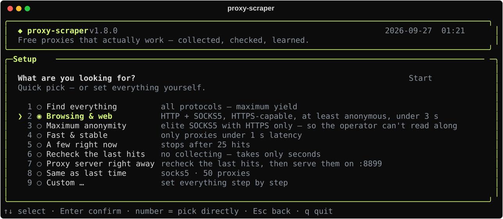

# Options and output

← [README](../README.md) · [All docs](README.md)

## All options

| Option | Description |
|---|---|
| `-i`, `--interactive` | setup wizard (shown automatically without arguments) |
| `-y`, `--yes` | start right away without the wizard |
| `--types http socks5` | only these protocols |
| `-l`, `--limit N` | only check the *N* most promising proxies |
| `--want N` | stop as soon as *N* matching proxies are found |
| `--country DE,AT` | only these countries |
| `--https-only` | only proxies that can tunnel HTTPS |
| `--anonymity elite` | minimum anonymity (`anonymous` or `elite`) |
| `--max-latency MS` | maximum latency |
| `--no-datacenter` | skip proxies whose exit is (probably) in a datacenter – those get blocked sooner |
| `--no-blocklisted` | skip proxies whose exit IP is on the SpamCop blocklist – those often get captchas |
| `--no-dnsbl` | skip the blocklist lookup |
| `--target URL` | only proxies that reach this site (repeatable) |
| `--recheck [FILE\|URL\|-\|live]` | only check proxies from a file, a URL, stdin (`-`), the last run, or the public live list |
| `--fast` | skip the HTTPS test (confirmation and anonymity still run) |
| `--no-geo` | skip the country lookup |
| `-c`, `--concurrency N` | simultaneous checks (default: 2000) |
| `-t`, `--timeout S` | timeout per proxy (default: 8 s) |
| `--discover` | search GitHub for new sources right now |
| `--no-cache` | download every list again (unchanged ones are normally skipped via ETag) |
| `--list-sources [N]` | show the source ranking (add `--json` for scripts: url, status, hit rate, checks, last change) |
| `--pick [N]` | print N proxies (default 1) from the hourly checked list and exit – no scan, same filters, plus `--min-uptime PERCENT`, `--min-speed KBPS` and `--works-on google,reddit,…` |
| `--verify` | with `--pick`: check the candidates from your machine first and print only those that pass now – 5 candidates per proxy asked for (10 to 60), up to 8 at a time, 90 s at most; exit code 3 if fewer than N passed |
| `--diagnose PROXY` | check one proxy and show what each check found, [state by state](check-states.md); exit code 0 nothing failed, 1 a check failed, 3 a check could not run |
| `--json` | with `--pick` or `--diagnose` (and `--list-sources`): the result as JSON on stdout |
| `--serve-host ADDR` | where the proxy server listens (default `127.0.0.1`; any other address needs a password or `--serve-open`) |
| `--serve-password SECRET` | clients must send this password in the proxy login; better set `PROXY_SCRAPER_SERVE_PASSWORD` |
| `--serve-open` | allow `--serve-host` without a password – only behind a firewall or with `docker -p 127.0.0.1:…` |
| `--rotate STRATEGY` · `--sticky SEC` | how the proxy server picks proxies, see [the proxy server](proxy-server.md) |
| `--serve-refill HOURS` | while serving, check fresh proxies every HOURS and add the hits to the pool |
| `--serve [PORT]` | afterwards serve as a rotating proxy on `127.0.0.1:PORT` (default: 8899) |
| `-o FILE` | also write all hits to this file; `-o -` prints them to stdout |
| `--export FORMATS` | extra files for other tools: `proxychains`, `clash`, `singbox`, `curl`, `pac`, `proxifier` or `all` |
| `-V`, `--version` | print the version |
| `--completion SHELL` | print the tab completion script for bash, zsh, fish or PowerShell |

Everything else: `proxy-scraper --help`

> [!TIP]
> For the GitHub search a logged-in [`gh`](https://cli.github.com/) or the `GITHUB_TOKEN` environment variable is enough. Without a token the API limit is 60 requests per hour, and only 40 repos are searched.

## Wizard presets

Started without arguments, a wizard asks what you are looking for:

<div align="center">

<sub>Illustration: the real interface, rendered with sample data by <a href="make_demo.py">docs/make_demo.py</a>. The numbers in it are made up.</sub>
</div>
| Preset | What it does |
|---|---|
| **Find everything** | all protocols, maximum yield |
| **Browsing & web** | HTTP + SOCKS5, HTTPS-capable, at least anonymous, under 3 s |
| **Maximum anonymity** | elite SOCKS5 with HTTPS only |
| **Fast & stable** | proxies under 1 s only |
| **A few right now** | stops after 25 hits |
| **Recheck the last hits** | no collecting, takes seconds |
| **Proxy server right away** | recheck the last hits, then serve them on :8899 |
| **Same as last time** | your previous choice |
| **Custom …** | protocols, countries, anonymity, HTTPS, target site, latency, amount, check mode |

Keys: <kbd>↑</kbd><kbd>↓</kbd> select · <kbd>Space</kbd> toggle · <kbd>1</kbd>–<kbd>9</kbd> jump · <kbd>Enter</kbd> next · <kbd>Esc</kbd> back · <kbd>q</kbd> quit. In scripts and cron jobs the wizard never shows up – pass options or `-y`.

## Output

Every run gets its own folder; `results/latest.txt` always names the newest one (on macOS/Linux there is also the symlink `results/latest`):

```
results/2026-09-24_18-42-07/
├── all.txt        socks5://203.0.113.10:1080   (fastest first)
├── http.txt       203.0.113.20:8080            (plain ip:port lists per type)
├── socks4.txt
├── socks5.txt
├── proxies.json   latency, country, HTTPS, anonymity, exit IP
└── proxies.csv
```
