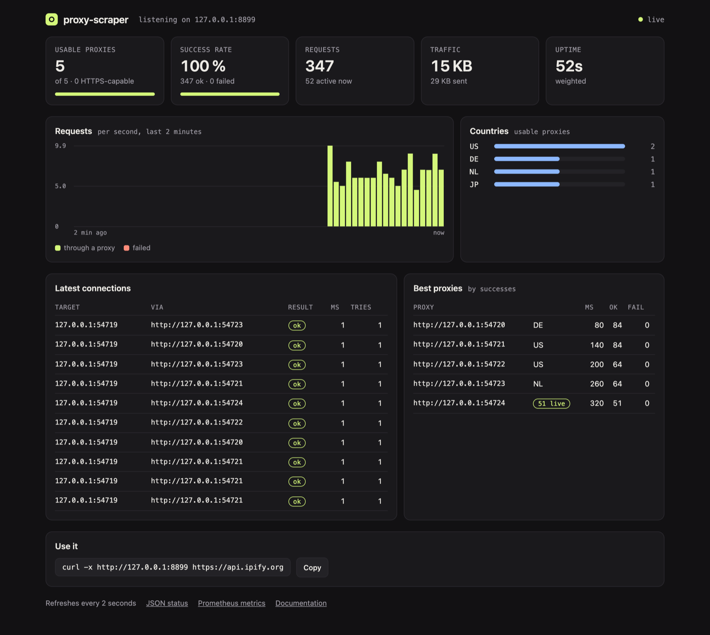

# Rotating proxy server

← [README](../README.md) · [All docs](README.md)

How to start it, the username wishes and the password are in the [README](../README.md#proxy-server). This page has the rotation options, how it behaves, the live dashboard and the pool API.

## Rotation and behaviour

| Option | What it does |
|---|---|
| `--rotate weighted` | default: fast and proven proxies more often, everyone gets a chance |
| `--rotate random` / `round-robin` | evenly, at random or in turn |
| `--rotate fastest` | always the fastest one that isn't busy |
| `--sticky 300` | the same site keeps its proxy for 5 minutes (logins, carts) |

- every connection goes through a different proxy (unless sticky); fast and proven ones are preferred
- `CONNECT` for HTTPS and plain HTTP requests; HTTP, SOCKS4 and SOCKS5 proxies can sit behind it (SOCKS5 with DNS through the proxy)
- HTTPS prefers proxies that passed the test with **verified TLS**; when no such proxy fits right now – none matches a wish like `country-de`, or they have all dropped out – it uses the others – your client's own certificate check still catches a proxy that breaks the encryption, so leave it on
- if a proxy stays silent inside the tunnel or returns an error page instead of TLS, the same first packet quietly goes to the next one – but only when sending it twice can't do anything twice: a TLS handshake (without 0-RTT data), nothing at all, or a single `GET`/`HEAD`/`OPTIONS`/`TRACE` request head
- three failures in a row and a proxy leaves the rotation – every 5 minutes those get re-checked and come back if they work again
- `--serve-refill 6` checks fresh proxies every 6 hours in the background (the live list with `--recheck live`, otherwise the last run + history) with the same checks and filters, and adds the hits – a server that runs for days doesn't run dry
- listens on `127.0.0.1` only (unless `--serve-host` says otherwise), optionally with a password; live view with requests, success rate, pool and the latest connections

In the wizard this is **Proxy server right away**.

### When a request is repeated, and the limits

A plain HTTP request goes to the next proxy when the first one fails **before** it could have sent anything (unreachable, SOCKS or `CONNECT` setup failed) – whatever the method. Once a request may have reached the target, only the safe methods `GET`, `HEAD`, `OPTIONS` and `TRACE` ([RFC 9110 §9.2.1](https://www.rfc-editor.org/rfc/rfc9110#section-9.2.1)) are tried again through another proxy. Everything else – `POST`, `PUT`, `PATCH`, `DELETE`, … – is not: a free proxy that delivers your request and then drops the connection would otherwise make the target run it twice. You get a `502` instead and decide yourself whether to repeat it. An `Idempotency-Key` header doesn't change that: whether the target deduplicates is up to the target.

The server marks its own answers with an `X-Proxy-Scraper` header, so you can tell them from the target's:

| Status | `X-Proxy-Scraper` | Meaning |
|---|---|---|
| `502` | `no-retry-after-send` | the proxy failed after the request may have gone out; not repeated because the method isn't safe |
| `502` | `no-proxy-answered` | no proxy could deliver the request |
| `408` | `request-timeout` | your client stopped sending the request body (no progress for `--timeout` seconds) |
| `503` | `too-many-clients` | more than 1,024 clients at once (`RotatingServer(max_clients=…)` in Python); comes with `Retry-After: 1` |

Limits: a client has `--timeout` seconds for its first byte and again for the rest of the request head, a request body has to make progress within `--timeout` per read, and a proxy may send at most 8 interim answers (`100 Continue`, `103 Early Hints`, 64 KiB in total) before its real one. Established `CONNECT` and SOCKS tunnels have no idle or lifetime limit – a WebSocket or a long download stays open as long as both sides want.

**Live dashboard:** open `http://127.0.0.1:8899/__proxy-scraper/` in a browser – the pool, success rate, traffic, a live chart of requests, countries, the best proxies and the latest connections, refreshed every two seconds. It needs nothing from the internet, and `--serve-password` protects it like the rest.

<div align="center"></div>

<a id="pool-api"></a>

## Proxy pool API

Some programs want a proxy *address*, not a proxy – to hand it to a browser, a worker or a queue. The same port answers plain HTTP requests with one:

```bash
curl http://127.0.0.1:8899/get                          # one proxy as JSON, chosen like a connection would be
curl "http://127.0.0.1:8899/get?country=DE&https=1&format=txt"   # → http://203.0.113.7:8080
curl "http://127.0.0.1:8899/all?protocol=socks5&limit=20"        # the 20 best SOCKS5 proxies
curl "http://127.0.0.1:8899/report?proxy=203.0.113.7:8080&ok=0"  # it failed you – three times and it's out
```

| Endpoint | What it does |
|---|---|
| `/get` | one proxy, picked by the `--rotate` strategy |
| `/pop` | like `/get`, and the proxy leaves the pool |
| `/all` | every usable proxy, best first (`limit=N`) |
| `/count` | totals by type and country |
| `/delete?proxy=IP:PORT` | take a proxy out |
| `/report?proxy=IP:PORT&ok=0` | feedback from your own requests |

Filters work on `/get`, `/pop` and `/all`: `country=DE,AT`, `protocol=socks5`, `https=1`, `anonymity=elite`, `max_latency=1500`, and `format=txt` for plain URLs. With `--serve-password` the API wants it as Basic auth, like the status page.

**Coming from [jhao104/proxy_pool](https://github.com/jhao104/proxy_pool)?** The endpoints, `type=https` and most JSON fields (`proxy`, `https`, `region`, `check_count`, `fail_count`, …) are the same, so point your code at port 8899 and most of it keeps working (three differences: there is no `last_time`, `anonymous` is true/false, not a string, and `source` is always `proxy-scraper`) – without Redis, and with proxies that passed the second-request, content and TLS checks:

```python
import requests
proxy = requests.get("http://127.0.0.1:8899/get?type=https").json()["url"]   # e.g. socks5://…, type included
requests.get("https://example.com", proxies={"http": proxy, "https": proxy})
```
